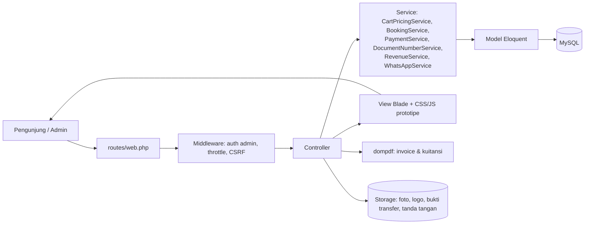
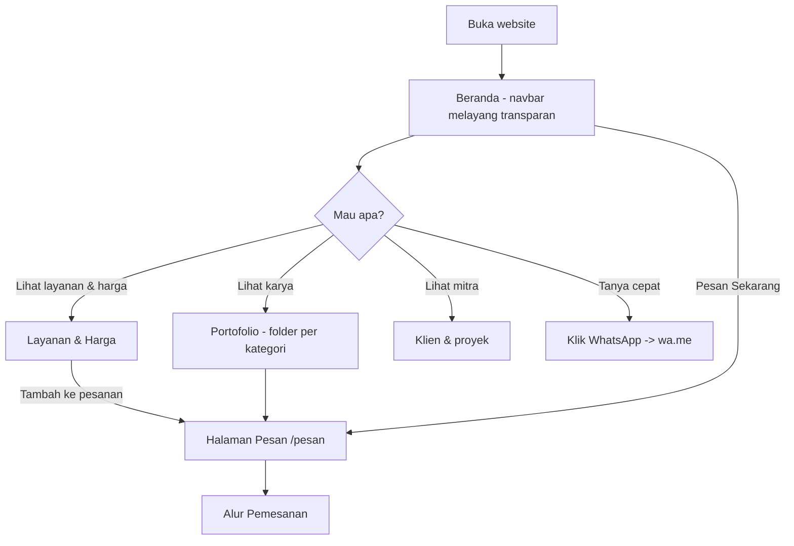
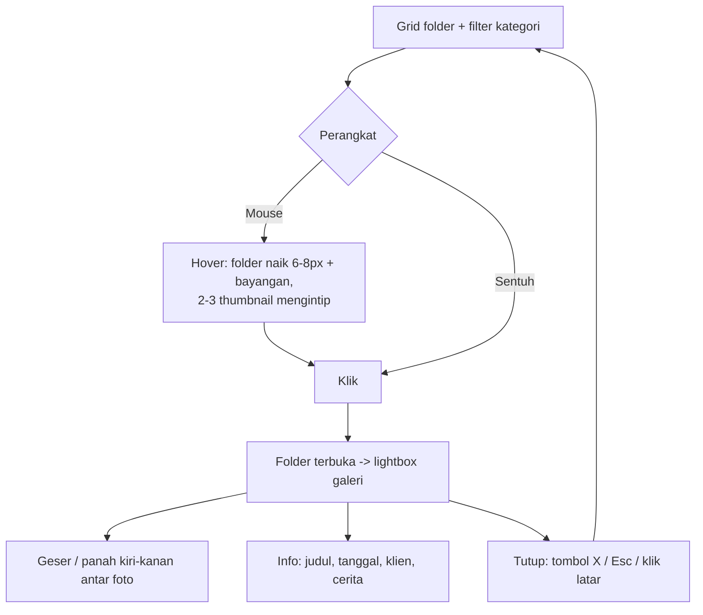
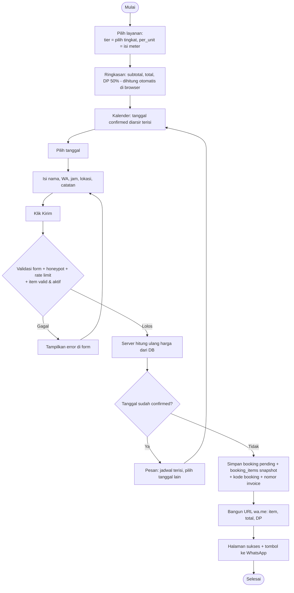
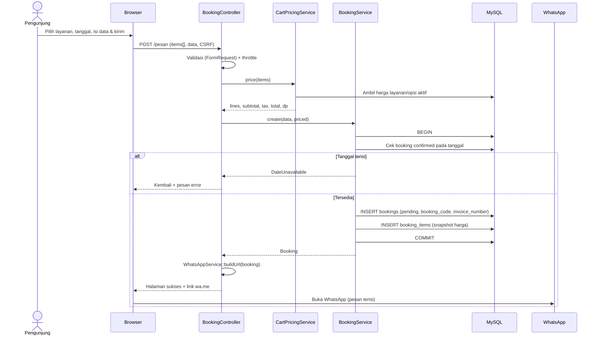
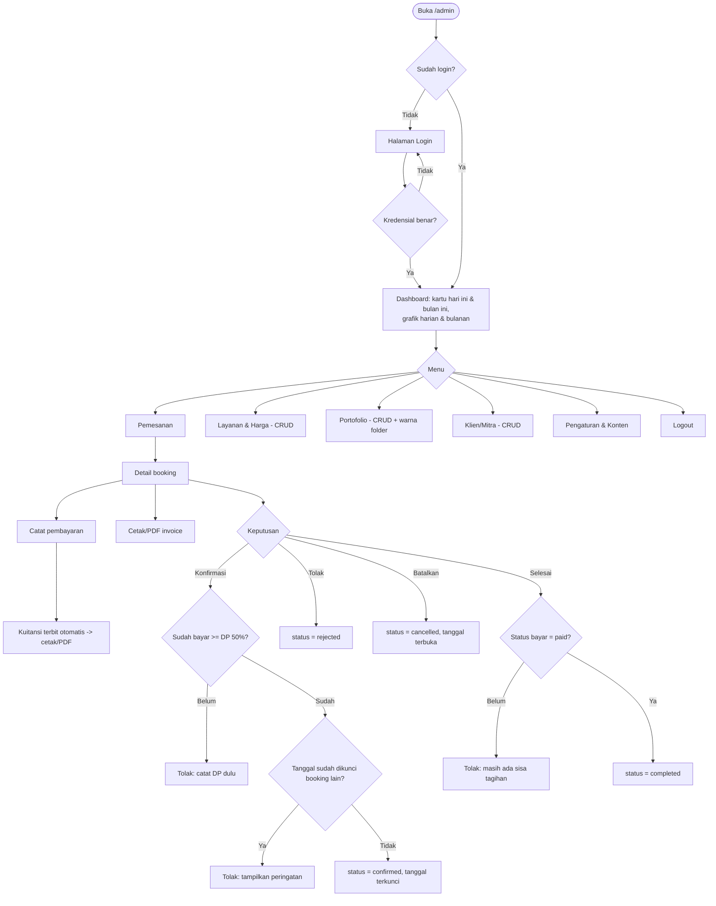
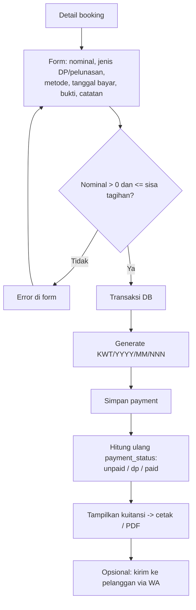
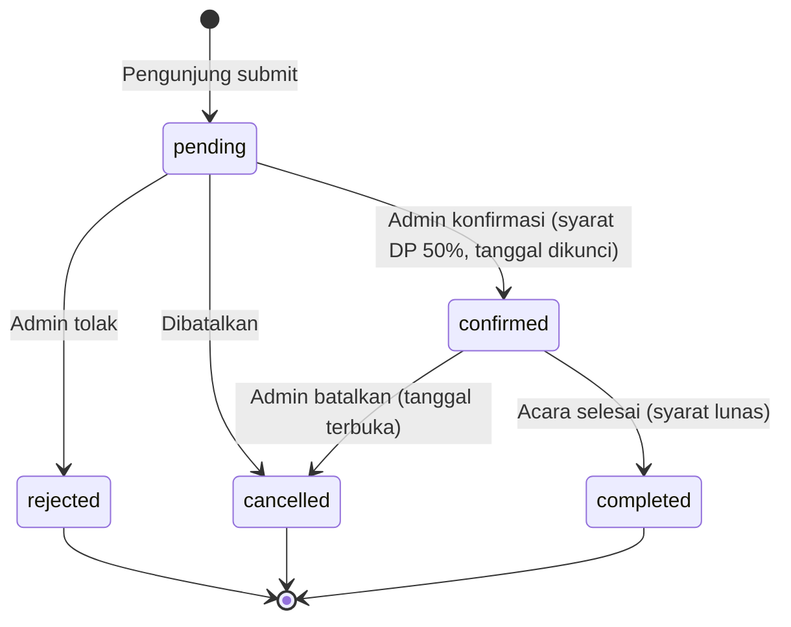
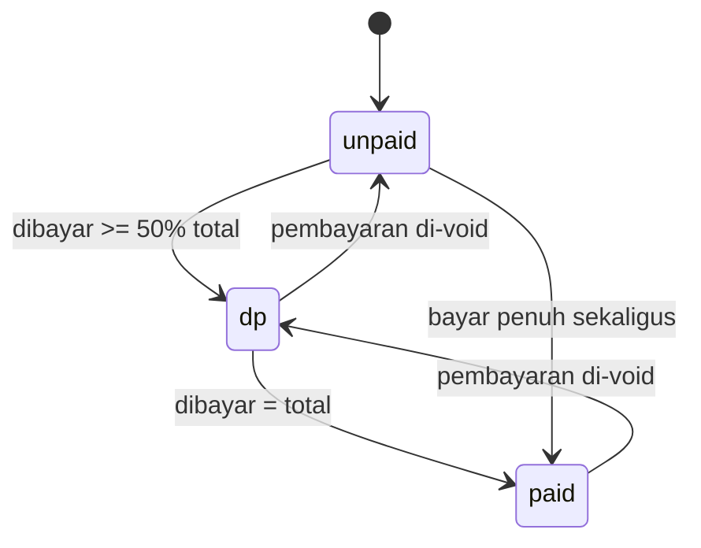

# Alur Program — FZM Production Mediatama (v0.2)

Diagram menggunakan Mermaid (render di GitHub, VS Code, atau mermaid.live).

> **Perubahan dari v0.1:** keranjang multi-layanan, DP 50% sebelum konfirmasi, pencatatan pembayaran, invoice & kuitansi, grafik pendapatan, interaksi folder portofolio, pengaturan konten oleh admin.

## 1. Arsitektur (Laravel MVC)


## 2. Alur Pengunjung (Keseluruhan)


## 3. Interaksi Folder Portofolio


## 4. Alur Pemesanan Publik (Keranjang + Cek Jadwal)


## 5. Sequence — Submit Booking


## 6. Alur Admin


## 7. Alur Pencatatan Pembayaran


## 8. State Booking & Status Bayar




## 9. Pseudocode Inti

**Hitung keranjang (server, sumber kebenaran harga)**
```php
$lines = collect($request->items)->map(function ($item) {
    $service = Service::active()->findOrFail($item['service_id']);

    if ($service->pricing_type === 'tier') {
        $opt = $service->options()->active()->findOrFail($item['option_id']);
        return ['service_id' => $service->id, 'service_option_id' => $opt->id,
                'description' => "{$service->name} – {$opt->name}",
                'qty' => 1, 'unit' => 'Paket', 'unit_price' => $opt->price,
                'subtotal' => $opt->price];
    }

    $qty = (int) $item['qty'];             // divalidasi 1..500
    return ['service_id' => $service->id, 'service_option_id' => null,
            'description' => $service->name,
            'qty' => $qty, 'unit' => $service->unit_label,
            'unit_price' => $service->unit_price,
            'subtotal' => $service->unit_price * $qty];
});

$subtotal = $lines->sum('subtotal');
$taxRate  = setting('tax_enabled') ? setting('tax_rate') : 0;   // persen
$tax      = intdiv($subtotal * $taxRate + 50, 100);             // pembulatan
$total    = $subtotal + $tax;
$dp       = (int) (ceil($total / 2 / 1000) * 1000);              // 50%, ke atas ke ribuan
```

**Konfirmasi booking (DP + anti double booking)**
```php
DB::transaction(function () use ($booking) {
    $booking = Booking::lockForUpdate()->findOrFail($booking->id);

    if ($booking->paidAmount() < $booking->dp_amount) throw new DpNotPaid();

    $taken = Booking::where('event_date', $booking->event_date)
        ->where('status', 'confirmed')
        ->where('id', '!=', $booking->id)
        ->lockForUpdate()
        ->exists();
    if ($taken) throw new DateAlreadyConfirmed();

    $booking->update(['status' => 'confirmed']);
});
// Pengaman tambahan: kolom generated `confirmed_date`
// (= event_date jika status confirmed, selain itu NULL) + UNIQUE index.
```

**Catat pembayaran**
```php
DB::transaction(function () use ($booking, $data) {
    $booking = Booking::lockForUpdate()->findOrFail($booking->id);
    $sisa = $booking->total - $booking->paidAmount();
    if ($data['amount'] <= 0 || $data['amount'] > $sisa) throw new InvalidAmount();

    $payment = $booking->payments()->create($data + [
        'receipt_number' => DocumentNumber::next('KWT'),   // KWT/2026/11/031
        'admin_id'       => auth()->id(),
    ]);

    $paid = $booking->paidAmount();
    $booking->update(['payment_status' =>
        $paid >= $booking->total ? 'paid' : ($paid >= $booking->dp_amount ? 'dp' : 'unpaid')]);
    return $payment;
});
```

**Nomor dokumen (berurutan per bulan)**
```php
// tabel document_sequences(prefix, period 'YYYY-MM', last_number) dikunci FOR UPDATE
// INV/2026/11/012 , KWT/2026/11/031
```

**Rekap pendapatan (Asia/Jakarta)**
```php
// Kartu
$today = Payment::valid()->whereDate('paid_at', today())->sum('amount');
$month = Payment::valid()->whereBetween('paid_at', [now()->startOfMonth(), now()->endOfMonth()])->sum('amount');

// Grafik harian (bulan dipilih) — hari tanpa pembayaran diisi 0
$daily = Payment::valid()->whereYear('paid_at', $y)->whereMonth('paid_at', $m)
    ->selectRaw('DAY(paid_at) d, SUM(amount) total')->groupBy('d')->pluck('total', 'd');

// Grafik bulanan (tahun dipilih)
$monthly = Payment::valid()->whereYear('paid_at', $y)
    ->selectRaw('MONTH(paid_at) m, SUM(amount) total')->groupBy('m')->pluck('total', 'm');
// "Reset" = periode berjalan otomatis berganti; data lama tetap ada.
```

**URL WhatsApp**
```php
$items = $b->items->map(fn ($i) => "- {$i->description} ({$i->qty} {$i->unit}): " . rupiah($i->subtotal))->implode("\n");
$text = "Halo FZM, saya ingin memesan.\n"
      . "Kode: {$b->booking_code}\n{$items}\n"
      . "Total: " . rupiah($b->total) . "\nDP 50%: " . rupiah($b->dp_amount) . "\n"
      . "Tanggal: {$b->event_date->translatedFormat('d F Y')}\nLokasi: {$b->event_location}\nNama: {$b->customer_name}";
$url = "https://wa.me/" . setting('wa_number') . "?text=" . rawurlencode($text);
```

## 10. Peta Rute
| Method | URL | Controller | Akses |
|---|---|---|---|
| GET | `/` | HomeController@index | Publik |
| GET | `/layanan`, `/layanan/{slug}` | ServiceController | Publik |
| GET | `/portofolio`, `/portofolio/{slug}` | PortfolioController | Publik |
| GET | `/klien`, `/klien/{id}` | ClientController | Publik |
| GET | `/tentang`, `/kontak` | PageController | Publik |
| GET | `/api/availability?month=YYYY-MM` | AvailabilityController | Publik |
| POST | `/api/cart/quote` | CartController@quote (pratinjau total) | Publik (throttle) |
| GET/POST | `/pesan` | BookingController@create/store | Publik (throttle) |
| GET | `/pesan/sukses/{kode}` | BookingController@success | Publik |
| GET/POST | `/admin/login` | Admin\AuthController | Tamu |
| GET | `/admin` | Admin\DashboardController | Admin |
| GET | `/admin/revenue?period=daily|monthly&date=` | Admin\RevenueController (data grafik) | Admin |
| ANY | `/admin/bookings`, `/admin/services`, `/admin/portfolios`, `/admin/clients`, `/admin/settings` | Admin\* (resource) | Admin |
| POST | `/admin/bookings/{id}/confirm|reject|cancel|complete` | Admin\BookingController | Admin |
| POST | `/admin/bookings/{id}/payments` | Admin\PaymentController@store | Admin |
| POST | `/admin/payments/{id}/void` | Admin\PaymentController@void | Admin |
| GET | `/admin/bookings/{id}/invoice` (`?pdf=1`) | Admin\DocumentController@invoice | Admin |
| GET | `/admin/payments/{id}/receipt` (`?pdf=1`) | Admin\DocumentController@receipt | Admin |

## 11. Urutan Implementasi per Sprint
1. **Sprint 1:** migrasi + seeder (layanan & tingkat harga, settings) → Home (navbar melayang), Layanan & Harga (read-only).
2. **Sprint 2:** Portofolio (folder + filter + lightbox), Klien, Tentang.
3. **Sprint 3:** Availability API → CartPricingService → form booking (keranjang) → BookingService → WhatsAppService → halaman sukses.
4. **Sprint 4:** Auth admin → dashboard & RevenueService (grafik) → CRUD layanan/portofolio/klien/pengaturan → PaymentService + nomor dokumen → invoice & kuitansi (print + PDF) → aksi status booking → promo, responsif, pencarian.
